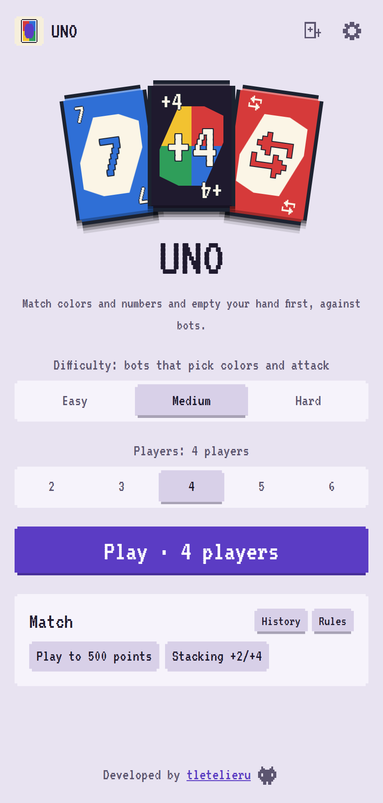
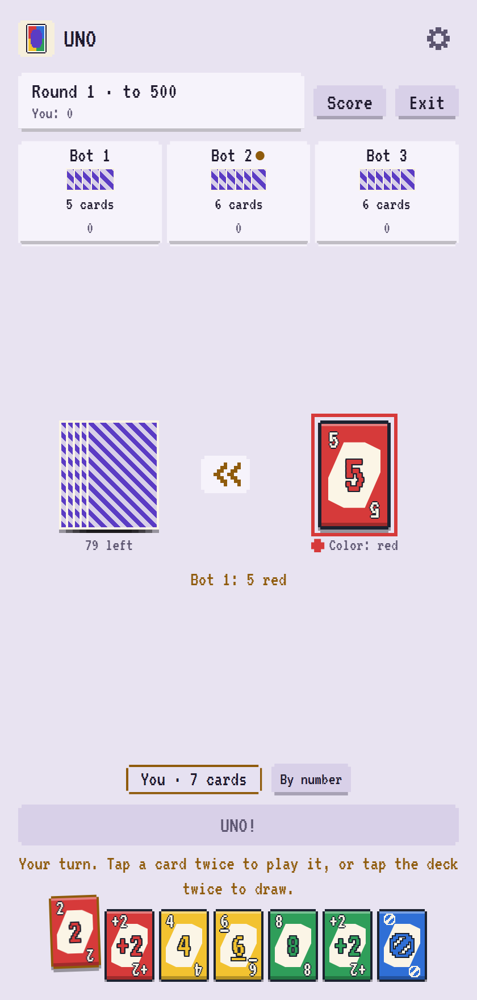

# UNO

Match colors and numbers and empty your hand first, against bots. Play on your phone or computer,
with 2 to 6 players.

No account and no backend. Everything runs on your device, and your match is saved after every move.

> UNO is a trademark of Mattel. This is a fan project; the name may change before release.

<p align="center">
  
  &nbsp;
  
</p>

## How to play

Each player gets 7 cards. On your turn, play a card that matches the top of the discard pile by
color, number or symbol, or play a wild card. There is no passing: if you can't or don't want to
play, draw a card and keep going until you play one.

Tap a card once to lift it and again to play it. Tap the deck once to lift its top card and again to
draw it.

| Card | Effect |
| --- | --- |
| Skip | The next player loses their turn |
| Reverse | Play changes direction. With 2 players it works like a Skip |
| +2 | The next player takes 2, then plays |
| Wild | You choose the color |
| Wild +4 | You choose the color, and the next player takes 4, then plays |

**Stacking** is on by default: answer a +2 with a +2 or +4, and a +4 with a +4 or a +2 of the chosen
color. The next player takes the total.

Press **UNO** when you play your second-to-last card. If a bot forgets, tap its seat and press
**UNO** before the next move: it takes 1. Bots catch you the same way.

The round winner scores the cards left in the other hands: numbers at face value, action cards 20,
wild cards 50. First to 500 wins the match (or 200, in Settings). The full rules, with pictures, are
inside the game.

## What you get

- **Three difficulties:** Easy plays the first card it can and is slow to call UNO or forgets it, Medium picks
  colors from its hand and attacks the player about to win, Hard also counts cards, remembers which
  colors each rival is missing and never lets a forgotten UNO slide. No bot ever sees your cards
- **2 to 6 players:** you against 1 to 5 bots
- **Dealer draw:** a spotlight picks who deals at the start of every match
- **House rules:** stacking (on by default) and draw until you can play (off by default)
- **Hints only on Easy:** on Medium and Hard you can tap any card, and the game tells you if it
  doesn't match
- **Your hand, your way:** drag cards to sort them, or sort by color or by number. Drawn cards fly
  in at the end of your hand
- **Match history:** finished and abandoned matches, with the score of every round
- **Saved matches:** reload, close the tab or turn off your phone, and the match comes back
- **Chiptune music:** its own themes, with a faster one when someone has one card left, and a switch
  to mute it

### Accessibility and comfort

Settings has larger text sizes, a regular font instead of the pixel one, color symbols (a shape for
each card color), sound and music switches and a switch to turn off animations. It also comes in
English and Spanish, with light and dark mode. Install it as an app and it works offline.

## How strong are the bots?

Each row is one bot against a table of the other, with the seat rotating every match. Matches to 500,
with stacking on.

| Bot | Against | Players | Matches | Wins | Even odds |
| --- | --- | --- | --- | --- | --- |
| Medium | Easy | 4 | 4000 | 44.0% ±1.5 | 25% |
| Hard | Easy | 4 | 4000 | 43.8% ±1.5 | 25% |
| Hard | Medium | 4 | 4000 | 25.7% ±1.4 | 25% |
| Medium | Easy | 2 | 2000 | 97.8% ±0.6 | 50% |
| Hard | Easy | 2 | 2000 | 98.3% ±0.6 | 50% |
| Hard | Medium | 2 | 2000 | 55.7% ±2.2 | 50% |

UNO is mostly luck. Medium and Hard beat Easy by a wide margin, mainly because Easy forgets UNO and
picks colors at random. Between bots that always call UNO, Hard's card counting gives a small edge
over Medium one on one and none at a full table; against a person, Hard catches every forgotten UNO.

## Run it locally

Requires Node 24 and pnpm 9.

```sh
pnpm install
pnpm dev        # http://localhost:5173/uno/
```

| Command | What it does |
| --- | --- |
| `pnpm test` | Runs the unit and property tests |
| `pnpm lint` | Runs ESLint |
| `pnpm typecheck` | Runs the type checks |
| `pnpm build` | Builds the app |
| `pnpm sim` | Compares Easy, Medium and Hard and prints win rates |
| `pnpm sim --hero hard --field medium --players 2 --matches 500` | Plays one bot against another |

## How it works

| Folder | What lives there |
| --- | --- |
| `packages/engine` | Rules, legal moves and scoring, with no UI code |
| `packages/bots` | Easy, Medium and Hard |
| `apps/client` | The game, built with React, Tailwind and Vite |
| `apps/sim` | Command line tool for bot matches |

The engine is pure and serializable, so saved matches, the bots and a future online server all share
it. Bots only receive what their seat can see, so they can't peek at your hand, and they run in a Web
Worker so the table never freezes. Thousands of random matches check that no card is ever lost or
duplicated, that every round ends with a winner and that illegal moves are rejected.

All cards, icons and music are original. See [the development plan](docs/PLAN.md), in Spanish, for
what comes next.

## License

Copyright (c) 2026 tletelieru. All rights reserved. See [LICENSE](LICENSE).

---

Developed by [tletelieru](https://tletelieru.github.io/tletelieru/) · [GitHub](https://github.com/tletelieru)
